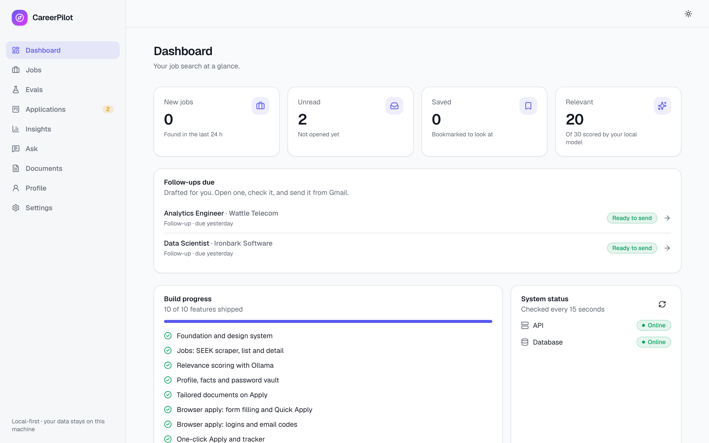
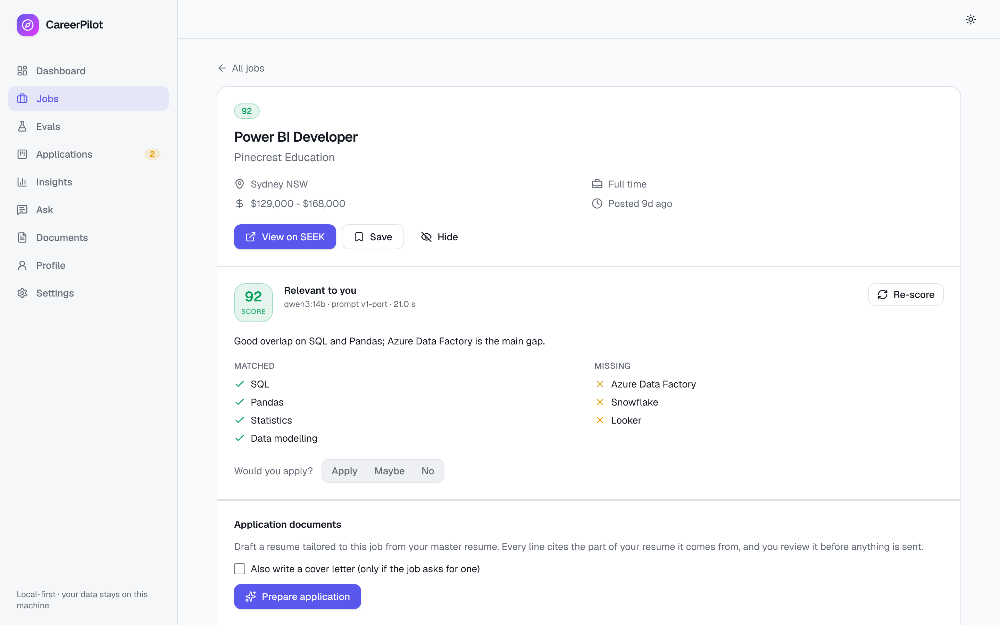
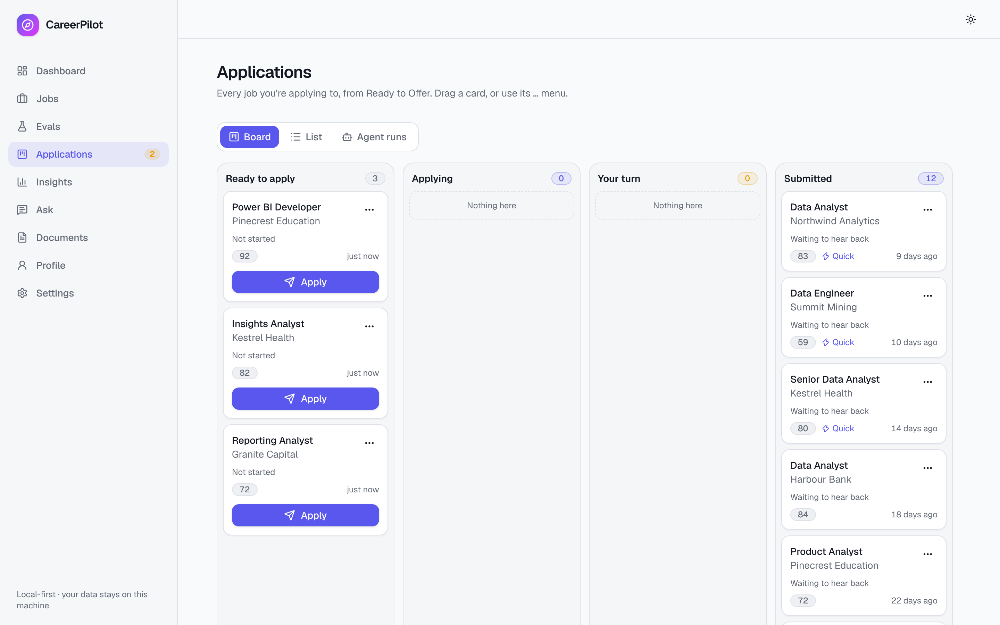
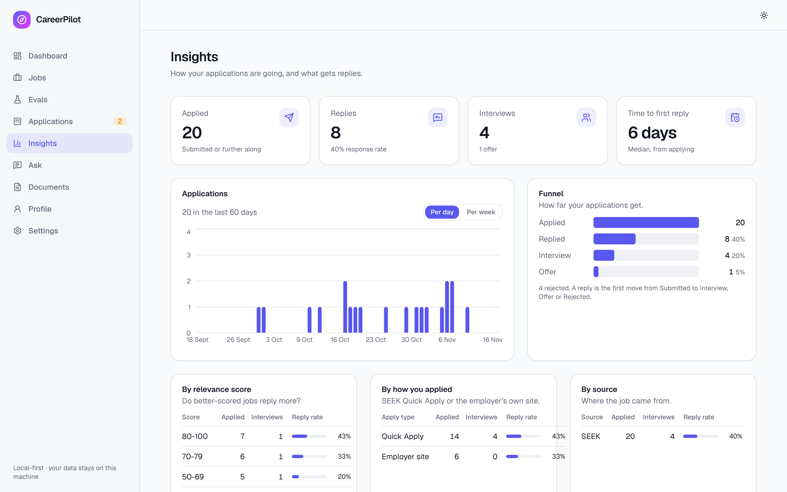
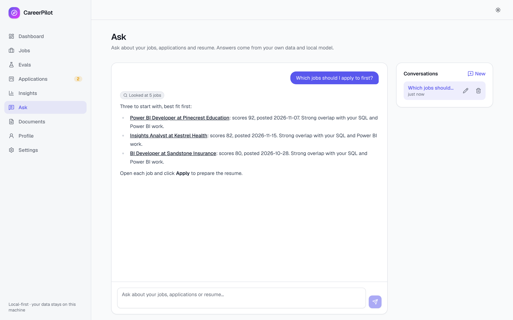
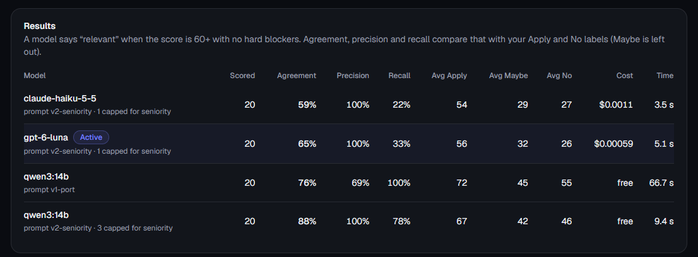

# CareerPilot

A self-hosted job-search assistant that runs on your own computer. It finds jobs on SEEK, scores how well each one fits you with a local model (or Claude or OpenAI, if you add a key), drafts a tailored resume from your real experience, fills in application forms in its own browser, and keeps track of everything until you hear back.

**You stay in control:** the agent never clicks Submit, never solves a CAPTCHA and never sends an email. Your data stays in your database, and your contact details never go to the model.



## What it does

| | |
|---|---|
| **Find** | Scrapes your SEEK searches every morning and keeps every job, with full-text search and filters |
| **Score** | A model (GPT-6 Luna by default, Claude, or a local Ollama model) scores each job 0-100 against your resume, with matched and missing requirements and hard blockers such as citizenship. Roles above your experience (a lead role when you have 3 years) are capped. An Evals page measures every model against your own labels, with cost and time |
| **Tailor** | Drafts a resume (and a cover letter when asked) for a job. Every line cites the part of your resume it comes from, and a checker flags anything your resume doesn't back up. Download as .docx or a one-page PDF |
| **Apply** | A Playwright browser agent fills in SEEK Quick Apply and employer forms, signs in or signs up (passwords in an encrypted vault, email codes read from Gmail), asks you what it can't answer, and stops before Submit |
| **Track** | A board from Ready to Offer, one-click Apply for many jobs at once, and Insights: applications per week, response rate, and what gets replies |
| **Follow up** | Drafts follow-ups at 7 and 14 days and a thank-you after an interview, ready to open in Gmail |
| **Ask** | A chat assistant with read-only tools over your jobs, scores, board and resume: "Which jobs should I apply to first?", "What skill keeps coming up missing?" |

| Job | Applications |
|---|---|
|  |  |
| **Insights** | **Ask** |
|  |  |

*Screenshots use a made-up person and made-up companies.*

## How it fits together

```text
 Browser / phone ──► web (Next.js, :3000) ──/api──► API (Rust, axum, 127.0.0.1:8080) ──► Postgres (Docker, :5433)
                                                     │        │
                                                     │        ├──► Ollama (local model, :11434)
                                                     │        └──► Claude / OpenAI (optional, monthly cap)
                                                     └──► browser worker (Playwright, 127.0.0.1:8090) ──► Chromium window
```

- **`backend/`**: Rust (axum, sqlx). The API, the scraper, and the workers for scoring, drafting, applying and emails. Every model call goes through one `LlmClient` (`backend/src/llm/`), which picks Ollama, Claude or OpenAI from the model's name and logs what cloud calls cost.
- **`web/`**: Next.js and Tailwind. All pages, and the `/api` pass-through to the backend.
- **`browser-worker/`**: TypeScript and Playwright. Drives a real Chromium window with its own profile, so you can watch it and step in.

## Requirements

- Ubuntu 24.04, natively or in WSL2 on Windows (WSLg shows the agent's browser window)
- Docker (Docker Desktop with WSL integration, or Docker Engine)
- Rust (stable, from [rustup.rs](https://rustup.rs)) and Node.js 22.18 or newer
- [Ollama](https://ollama.com) and a GPU with about 12 GB of memory for qwen3:14b (qwen3:8b works with less)

## Quick start

```bash
git clone https://github.com/TeotiaAbhishek/CareerPilot-AI.git ~/code/careerpilot-ai
cd ~/code/careerpilot-ai
scripts/setup.sh     # once: database, settings files, vault key, builds, Chromium, the model
scripts/dev.sh       # API, web app and browser worker together. Ctrl+C stops them
```

Open http://localhost:3000, then:
1. **Profile:** paste your resume (Markdown) and fill in your work rights.
2. **Settings:** add your SEEK searches, and click **Sign in to SEEK in the agent's browser** once.
3. **Jobs:** click **Scrape now**. Scores appear as the model gets through them.

`scripts/setup.sh` creates `backend/.env` with a new `VAULT_KEY`. **Back it up and never commit it.** Without it, saved passwords can't be decrypted.

## Keep it always on, and use it from your phone

```bash
scripts/install-services.sh
```

This runs the API, the web app and the browser worker as systemd user services. They start with Ubuntu and restart if they crash. Run it again after pulling new code. `scripts/install-services.sh --remove` undoes it.

On Windows, also make sure WSL and Docker start when you sign in:
- **Docker Desktop:** Settings → General → *Start Docker Desktop when you sign in*.
- **WSL:** Task Scheduler → *Create Task* → trigger *At log on* → action `wsl.exe` with arguments `-d Ubuntu-24.04 --exec sleep infinity`, *Hidden*.
- **Sleep:** the PC can sleep. A Task Scheduler task with *Wake the computer to run this task* wakes it at 8:00 and calls `wsl.exe -d Ubuntu-24.04 --exec curl -s -X POST http://127.0.0.1:8080/api/scrape`. Turn on *Allow wake timers* in Power Options.

**From your phone:** install [Tailscale](https://tailscale.com) in Ubuntu and on your phone (same account), then:

```bash
curl -fsSL https://tailscale.com/install.sh | sh
sudo tailscale up
sudo tailscale serve --bg 3000
```

`tailscale serve` prints an `https://<your-pc>.<tailnet>.ts.net` address. It works on your own signed-in devices only, never on the public internet. **The app has no login page, so never expose it publicly.**

## Cloud models (optional)

Scoring, tailoring and Ask can use Claude or OpenAI instead of the local model. The apply agent always stays local, because form pages hold your details.

1. Get a key: Claude at [console.anthropic.com](https://console.anthropic.com) (Settings → API keys), OpenAI at [platform.openai.com](https://platform.openai.com/api-keys). Both need a little prepaid credit.
2. Add it to `backend/.env` as `ANTHROPIC_API_KEY=` or `OPENAI_API_KEY=` and restart the API.
3. The models appear in every picker on **Settings**. Each provider has a monthly cap ($10 by default). Past it, calls go to your local model until next month.

What they see: the job ad and your resume **without** your name, email, phone or links, which are removed by code before the call. Prices are per million tokens:

| Model | Used for | Input | Output |
|---|---|---|---|
| `claude-haiku-5-5` | Scoring | $0.10 | $0.50 |
| `gpt-6-luna` | Scoring | $0.10 | $0.50 |
| `claude-sonnet-5-5` | Tailoring, Ask | $2 | $10 |
| `gpt-6.1-sol` | Tailoring, Ask | $2 | $10 |

**Compare them on your own data:** Evals → *Run evals* scores your labelled jobs with each model (agreement, cost and time), and *Compare tailored resumes* drafts the same jobs with each model side by side, with the checker's flags.



Results on my own labels: 20 jobs from one week scored by each model (a job counts as "relevant" at 60+), and tailored resumes for 5 of them:

| Task | Model | Agreement with my labels | Recall | Flags per resume | Cost per job | Time per job |
|---|---|---|---|---|---|---|
| Scoring | `qwen3:14b` (local), first prompt | 76% | 100% | | free | 66.7 s |
| Scoring | `qwen3:14b` (local), `v2-seniority` | **88%** | 78% | | free | 9.4 s |
| Scoring | `claude-haiku-5-5` | 59% | 22% | | $0.0011 | 3.5 s |
| Scoring | `gpt-6-luna` | 65% | 33% | | $0.00059 | 5.1 s |
| Tailoring | `qwen3:14b` (local) | | | 15.8 | free | 72 s |
| Tailoring | `claude-sonnet-5-5` | | | **4.4** | $0.03 | 11 s |
| Tailoring | `gpt-6.1-sol` | | | 13.6 | $0.02 | 21 s |

This is a first, small run (20 labels picked in a hurry), so the scoring numbers are rough; I'll redo it with more labels. I score with `gpt-6-luna` and tailor resumes and run Ask with `claude-sonnet-5-5`. These are the defaults on a fresh install; without an API key, each falls back to the local model.

## Settings

`backend/.env` (made from `backend/.env.example`):

| Variable | What it is |
|---|---|
| `DATABASE_URL` | Postgres. The Docker one is on port 5433 |
| `SCRAPE_DAILY_AT`, `SCRAPE_TIMEZONE` | When the daily scrape runs, or `off` |
| `OLLAMA_URL`, `OLLAMA_NUM_CTX` | Where Ollama runs, and its default context size |
| `ANTHROPIC_API_KEY`, `OPENAI_API_KEY` | Optional: turn on Claude and OpenAI models. Never commit them |
| `VAULT_KEY` | The password vault key. Created by `setup.sh` |
| `GMAIL_CLIENT_ID`, `GMAIL_CLIENT_SECRET` | Optional: a Google OAuth "Desktop app" client with the Gmail API, for sign-up codes (read-only) |
| `RESUME_PATH` | Optional: a Markdown resume to import on first start. `data/` is git-ignored |

Models, the relevance threshold, how many applications run at once, the daily limit and the other switches are on the **Settings** page.

## Development

```bash
cd backend && cargo fmt --check && cargo clippy --all-targets -- -D warnings && cargo test
cd web && npm run lint && npm run typecheck && npm test
cd browser-worker && npm run typecheck && npm test
```

The backend tests need Postgres (`docker compose up -d`) and use a fake Ollama, fake Claude and OpenAI servers and a fake browser worker, so they never call a real model or website and never cost anything. CI runs all of this on every pull request.

## Security

See [SECURITY.md](SECURITY.md): what's encrypted, what the model sees, what the agent will never do, and how to report a problem.

## Licence

[MIT](LICENSE)
